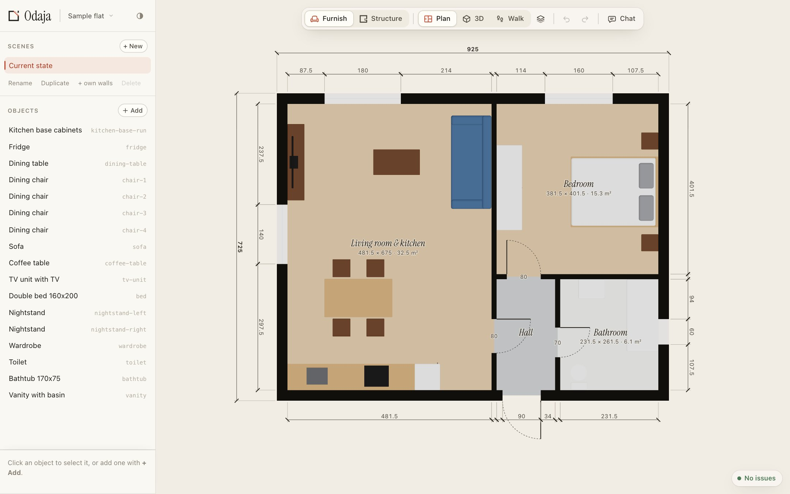
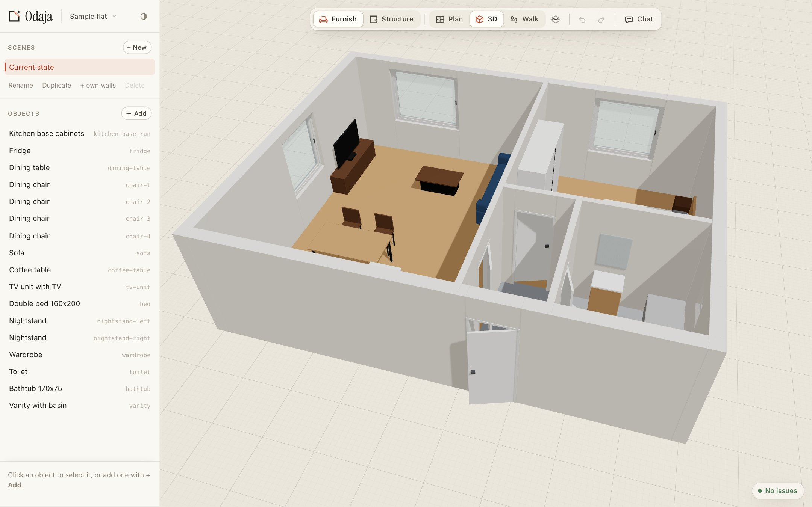
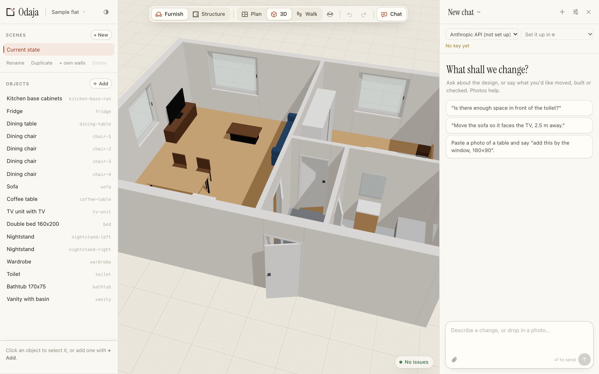
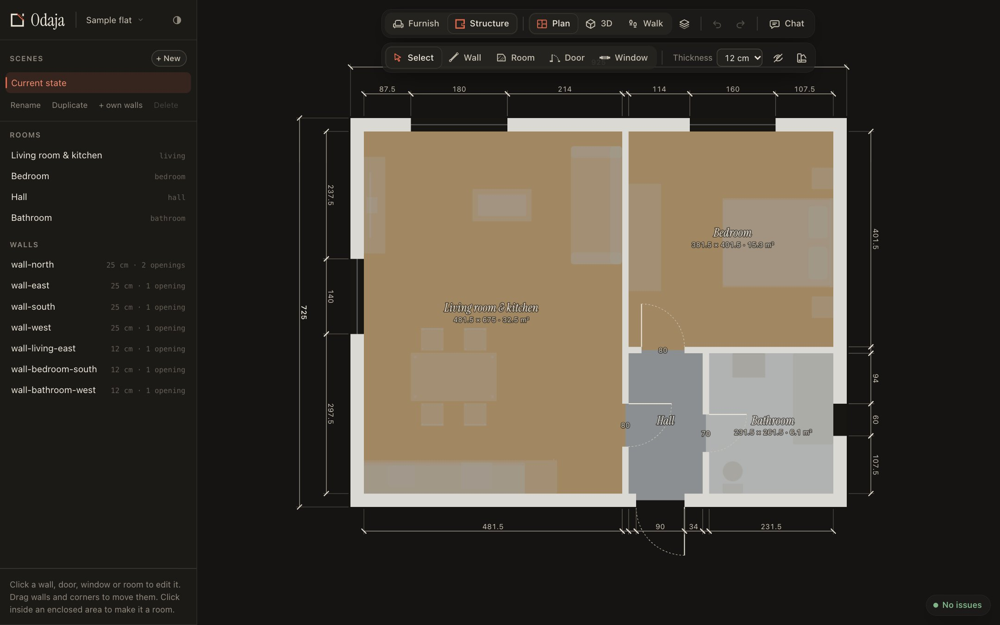

# Odaja

**Plan your home in 3D, and talk it over with an AI before anything is built.**
Draw the walls (or trace a floor plan), furnish the rooms, put tiles and paint
on the surfaces, and walk through it. Odaja (Одаја) means "room".

**Try it: [atanasovskipetar.github.io/odaja](https://atanasovskipetar.github.io/odaja/)**.
Nothing to install, no account. Your home stays in your browser.



## What you can do

- **Walls, doors and windows:** draw them, or start from a photo or PDF of a
  floor plan set to scale. Rooms get their areas, walls get their dimensions.
- **Furnish:** built-in furniture you can resize, your own pieces built from
  parts, or 3D models (GLB, FBX, OBJ, USDZ and more). Keep favourites in your
  library.
- **Finishes:** tiles, paint and floors on walls and floors, with real tile
  sizes, patterns and quantities. Ask the chat to turn a photo of a tile into a texture.
- **Look around:** plan, 3D, and a walk-through at eye height. Try layouts side
  by side as scenes.
- **Sunlight:** give the flat's location and which way it faces, then watch
  the real sun move through your windows on any day of the year, in 3D or
  walking through.
- **Checks:** furniture in walls, overlaps, blocked doors, too little space in
  front of a toilet or a wardrobe, each with a quick fix.



## Your data

Odaja works in your browser, and nothing is sent anywhere. Your home is saved
there as you work. It works offline too, and you can install it as an app.

- **Save to a file** (⌘S) to keep a copy, move to another computer or share it:
  a `.odaja` file has everything in it, including the 3D models.
- **Your library** of furniture and materials travels as `.odaja-item` and
  `.odaja-library` files.
- **Export** the plan or a view as PNG or JPG.

## Talk it over with an AI



Open the chat (⌘J) and ask: "Is there enough space in front of the toilet?",
"Move the sofa so it faces the TV", or paste a photo of a table and say "add
this by the window". The AI uses the same tools you do, and every change can be
undone.

Bring your own key for **Anthropic, OpenAI, Google Gemini or OpenRouter**, or
run a model on your computer with **Ollama** or **LM Studio**. Keys stay in your
browser and go only to their own provider. Usage is billed to you there.

**With a Claude subscription:** install the companion below (one command). Its
chat offers "Claude Code (your subscription)", using the Claude Code installed
and signed in on your computer, for your own use.

## The companion: on your computer, with your Claude subscription

`odaja` is a small program that runs the same Odaja on your computer, with
three extras:

- **Your Claude subscription in the chat:** "Claude Code (your subscription)"
  uses the Claude Code installed and signed in on your computer, for your own
  use. No API key needed.
- **Homes are real folders** (in `Documents/Odaja`), plain JSON files you or any
  tool can edit; changes show up live.
- **An MCP server**, so Claude Desktop, Claude Code and other MCP clients can
  work on your design with Odaja's tools.

**Install** (macOS or Linux), in a terminal:

```bash
curl -fsSL https://atanasovskipetar.github.io/odaja/install.sh | sh
```

On Windows, in PowerShell:

```powershell
irm https://atanasovskipetar.github.io/odaja/install.ps1 | iex
```

Then start it with `odaja`: it opens Odaja in your browser (usually
http://localhost:5180) and keeps running in that terminal until you press
Ctrl+C. Run the install command again to update. A home saved as `.odaja` on
the website opens in the companion, and back.

To use your Claude subscription, have [Claude Code](https://claude.com/claude-code)
installed and signed in (`claude auth login`), then pick "Claude Code (your
subscription)" in the chat.

> Prefer to download by hand? The programs are on
> [Releases](https://github.com/AtanasovskiPetar/odaja/releases/latest). A file
> downloaded in a browser needs `chmod +x` and, on macOS, `xattr -d
> com.apple.quarantine odaja-macos-*` once, because it isn't notarised by Apple.

**Where it goes, and uninstalling.** The program is `~/.local/bin/odaja`. On
first start it unpacks its app files into `~/.odaja/app/` and keeps a list of
recent homes in `~/.odaja/`. Your homes and furniture library are in
`~/Documents/Odaja/`. To remove Odaja, delete the program and `~/.odaja`:

```bash
rm ~/.local/bin/odaja
rm -rf ~/.odaja
```

Your homes stay in `~/Documents/Odaja/`; delete that folder too only if you
want them gone. On Windows, delete `%LOCALAPPDATA%\Programs\Odaja` and
`%USERPROFILE%\.odaja`, and remove that Programs folder from your PATH
(Settings → System → About → Advanced system settings → Environment
Variables); your homes are in `Documents\Odaja`.

**Claude Code** talking to Odaja directly (with Odaja running):

```bash
claude mcp add odaja -- ~/.local/bin/odaja mcp
```

**Claude Desktop:** Settings → Developer → Edit Config, add Odaja to
`claude_desktop_config.json` (the full path to `odaja`), and restart Claude
Desktop:

```json
{
  "mcpServers": {
    "odaja": { "command": "/Users/you/.local/bin/odaja", "args": ["mcp"] }
  }
}
```



## Developing

```bash
bun install
bun run companion  # build and start the companion, and open it (http://localhost:5180)
bun run dev        # the same with live reloading while you change the code (http://localhost:5173)
bun run typecheck
```

[AGENTS.md](AGENTS.md) describes how the code is laid out and how to run it in
other ways. [docs/project-format.md](docs/project-format.md) is the home file
format, and [docs/web-plan.md](docs/web-plan.md) is how the website came to be.
Every push to `master` publishes the website. A version tag (`v0.1.0`, matching
`package.json`) builds the companion and publishes a release.

## Licence

[MIT](LICENSE)
